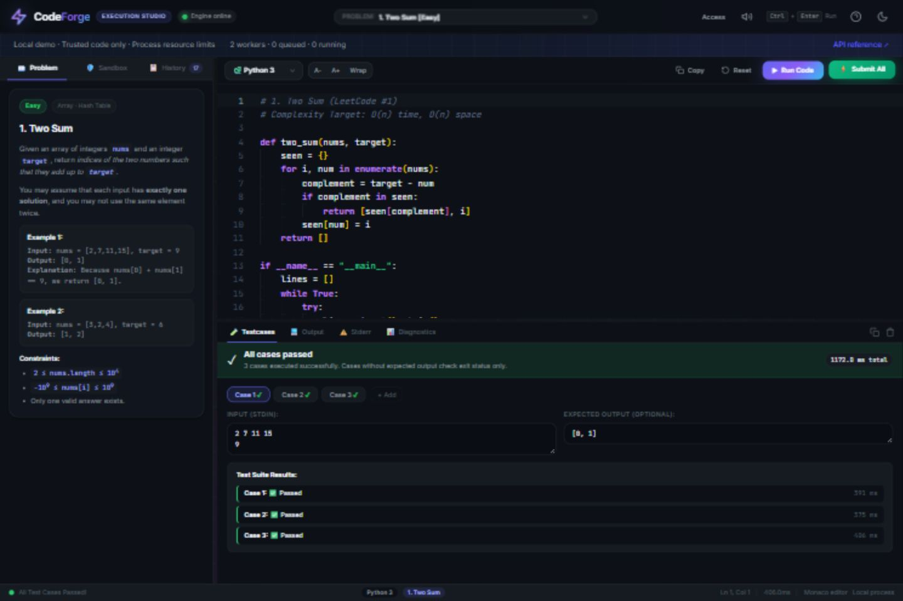
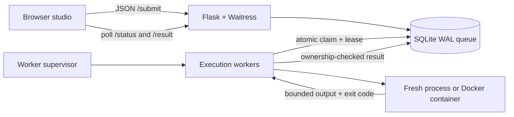

# CodeForge · Sandboxed Code Execution Engine

A local-first code execution studio for Python and C: edit a program, supply stdin, run test cases, and inspect durable results. Built with Flask, a supervised multiprocessing pool, SQLite and an optional Docker execution backend.

**For a portfolio demo:** start the app, open Two Sum, and click **Submit All**. The editor, queue, real worker processes, resource limits, results and history all run on your machine. See the [five-minute interview walkthrough](docs/DEMO.md).



## Start the local demo

Requires **Python 3.11+**. A C compiler (`gcc`, `cc` or `clang`) is optional for local C execution. Python examples work without one. Node is only needed for frontend example tests, not to run the app.

```powershell
# Windows — installs dependencies into .venv and starts the application
.\scripts\start.ps1
```

Or use the same commands on any platform:

```sh
python -m venv .venv
# Windows: .venv\Scripts\activate
# macOS/Linux: source .venv/bin/activate
python -m pip install -r requirements.txt
python run.py
```

Open **http://127.0.0.1:5000**. Press Ctrl+C to stop. Use `python run.py --port 5055 --workers 2` to change the port or worker count. The default process backend is **for trusted local code only** and the launcher binds to loopback.

Monaco supplies syntax highlighting, shortcuts and editor tooling when its CDN is available. An editable plain-text fallback starts immediately and preserves edits when Monaco finishes loading. Fonts also have local fallbacks. Drafts are saved per problem and language in this browser; results live in SQLite.

## What the project demonstrates

- **End-to-end execution:** Python/C, stdin, multiple test cases, exit codes, stderr, measured wall time and submission history.
- **A durable queue:** atomic capacity checks and claims; SQLite WAL with connections closed after every operation.
- **Fault recovery:** supervised workers, independent heartbeat threads, expired-lease recovery and ownership-checked result writes.
- **Bounded workloads:** wall time, memory limits, process-tree cleanup, source/input limits, and a combined stdout/stderr budget enforced while reading pipes.
- **An explicit deployment boundary:** Docker per submission, bearer token authentication, production configuration validation, readiness checks, a WSGI server and Compose packaging.
- **Reviewable engineering:** API contract, security regression tests, concurrent queue tests, real HTTP smoke checks, browser starter-program tests, and Windows/Linux CI.

The UI reports actual execution data. Peak memory is not measured and no synthetic memory number is displayed.

## Architecture



The API never evaluates submitted code. `queued → running → completed` records an execution attempt; a non-zero exit code can still have status `completed`. `failed` denotes an engine error. Always inspect `exit_code`, `resource_usage.timed_out` and `resource_usage.output_truncated`.

Claims are exclusive while a lease is valid. Recovery is **at-least-once**, not exactly-once: a job can run again after a crash or expired lease. Writes from a previous owner cannot replace the current owner's result. Live workers are never blindly requeued on another pool's startup.

## API

The machine-readable contract is [docs/openapi.json](docs/openapi.json), also served at `/openapi.json`.

| Route | Purpose |
| --- | --- |
| `POST /submit` | `{language, source, stdin?}` → `201` with ID and links |
| `GET /status/<id>` | Lifecycle state and submission time |
| `GET /result/<id>` | Output, exit code and resource usage; `409` while pending |
| `GET /submissions?limit=20` | Latest submissions, newest first |
| `GET /health` | API liveness and configured capabilities |
| `GET /ready` | Database and worker heartbeat readiness; `503` when unavailable |
| `GET /api/config` | Public limits, languages and authentication requirement |

```sh
curl -X POST http://127.0.0.1:5000/submit \
  -H 'Content-Type: application/json' \
  -d '{"language":"python","source":"print(input().upper())","stdin":"hello"}'
```

Source and stdin limits count UTF-8 bytes. Invalid fields return `400`, incorrect content type `415`, oversized input `413`, and a full queue `429` with `Retry-After`. Responses carry `X-Request-ID`. Authenticated endpoints require `Authorization: Bearer <API_TOKEN>` whenever a token is configured. The browser's **Access** dialog stores it only in the current tab's session. All token holders share one history; this is a single-operator service, not a multi-user account system.

## Docker deployment path

Requires Docker with Linux containers and Compose. Build the runner explicitly; submissions never trigger image downloads or silently fall back to the host process backend.

```sh
cp .env.example .env
python -c "import secrets; print(secrets.token_hex(32))"
# Paste the generated token into API_TOKEN in .env.
# On Linux, set DOCKER_GID to: stat -c '%g' /var/run/docker.sock

docker build -f sandbox/Dockerfile -t codeforge-sandbox:local .
docker compose up --build -d
docker compose ps
curl http://127.0.0.1:5000/ready
```

On Windows, use `Copy-Item .env.example .env`. Docker Desktop must use Linux containers. Open the same UI and enter your token through **Access**. Compose binds port 5000 to loopback; this is suitable for a local deployment demonstration. For a remote deployment, place an authenticated HTTPS reverse proxy in front, configure network exposure deliberately, and run the worker on a dedicated host.

Each submission gets a non-root container with no network, a read-only root filesystem, dropped capabilities, no-new-privileges, PID/memory/CPU limits, bounded scratch tmpfs and no host mounts. Compilation also happens inside this container. The worker mounts the Docker socket; the API and submission containers do not. **Docker socket access is powerful host access**: treat the worker as privileged infrastructure, use a dedicated machine, and consider rootless Docker with working cgroup limits. Docker shares a kernel; a public hostile multi-tenant judge needs further hardening (for example gVisor or microVMs), per-user quotas and ownership.

`/ready` reports live workers, not a continuous Docker daemon probe. Workers verify the daemon and runner image at startup; later daemon failures appear as failed execution results. The container has its own lifetime alarm and automatic removal, plus worker-side cleanup.

```sh
docker compose logs -f api worker
docker compose down           # preserves the named database volume
# Explicit data deletion: docker compose down --volumes
```

SQLite is a deliberate **single-host** choice. Use a local disk/volume, not an NFS share. Back up with SQLite's backup API or stop both services before copying the database and its WAL files. Retention removes finished rows after 24 hours; freed pages are reused. It does not immediately shrink the database file.

## Configuration

Precedence: environment variables, optional `config.json`, then defaults. `.env` is read by Compose only; `python run.py` uses your shell environment or `config.json`. Tokens and local database files are ignored by Git and excluded from Docker builds.

| Setting | Default | Meaning |
| --- | --- | --- |
| `APP_ENV` | `development` | `production` requires Docker and a token |
| `SANDBOX_BACKEND` | `process` | `process` for trusted demos; `docker` for OS isolation |
| `SANDBOX_IMAGE` | `codeforge-sandbox:local` | Prebuilt Linux runner image |
| `API_TOKEN` | empty | Production requires at least 32 ASCII characters; generate randomly |
| `MAX_WORKERS` | `4` | Parallel execution workers |
| `TIMEOUT_SECONDS` | `2` | Program wall-clock timeout |
| `CPU_SECONDS` | `2` | POSIX CPU budget; Windows uses wall time |
| `MEM_MB` | `256` | Address-space/Job Object/container memory budget |
| `MAX_CODE_BYTES` | `1048576` | Source size |
| `MAX_STDIN_BYTES` | `65536` | stdin size |
| `MAX_RESULT_BYTES` | `4194304` | Combined stdout/stderr budget |
| `MAX_PENDING_JOBS` | `100` | Queued plus running capacity |
| `WORKER_HEARTBEAT_SECONDS` | `2` | Worker lease renewal interval |
| `WORKER_STALE_SECONDS` | `60` | Expiry threshold; must exceed 3 heartbeat intervals |
| `RESULT_RETENTION_SECONDS` | `86400` | Finished-history retention |
| `DB_PATH` | project `submissions.db` | Shared API/worker SQLite location |
| `POLL_INTERVAL` | `0.2` | Idle queue polling interval |
| `SQLITE_TIMEOUT` | `10` | Database lock wait |

C compilation has an additional 10-second budget. Docker startup and cleanup add overhead beyond the measured program wall time. Windows Job Objects cap memory and clean up descendants; they do not isolate filesystem or network access. Python source filters and compiler warnings are convenience checks, **not security boundaries**. Local process mode cannot safely accept arbitrary internet submissions.

## Validation

```sh
python -m pip install -r requirements-dev.txt
python -m pytest -q
node --check frontend/js/app.js
python scripts/smoke.py               # requires a running app
# alternate port: python scripts/smoke.py --url http://127.0.0.1:5055
```

Tests use temporary databases. Browser examples are extracted with Node and their exact programs are executed against their shipped test cases. Local C checks skip when no compiler exists. Docker tests are opt-in:

```sh
RUN_DOCKER_TESTS=1 python -m pytest -q tests/test_docker_integration.py
# PowerShell: $env:RUN_DOCKER_TESTS='1'; python -m pytest -q tests/test_docker_integration.py
```

CI runs the regular suite on Windows/Linux with Python 3.11/3.12, checks JavaScript syntax, builds the application and runner images, and runs the Docker integration tests on Linux. A configured workflow is not evidence that a remote CI run has passed.

## Layout

```text
api/                 HTTP validation, auth, frontend and health routes
frontend/            Editor, test cases, history and diagnostics
sandbox/             Bounded runtime, Docker runner and platform limits
worker/              Supervision, leases and graceful shutdown
database.py          Durable queue, claims, results and retention
config.py            Environment/file settings with startup validation
tests/               API, queue, execution and demo regressions
scripts/             Windows startup and HTTP smoke check
docs/                OpenAPI contract and interview walkthrough
compose.yaml         API + worker with shared persistent volume
```
